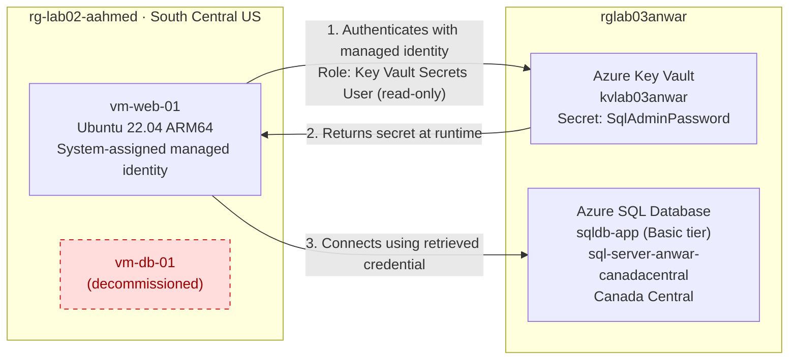

# Lab 03: Modernizing to PaaS & Securing Secrets in Azure

Migrating an application's database from a self-managed virtual machine (IaaS) to **Azure SQL Database** (PaaS), and securing its credentials with **Azure Key Vault** and a **managed identity**, so no password is stored in code or on the server.

📹 **Video walkthrough:** [Watch on Loom](LOOM_LINK_HERE)

---

## Table of Contents

- [Overview](#overview)
- [Architecture](#architecture)
- [Azure Services Used](#azure-services-used)
- [Implementation](#implementation)
- [Troubleshooting: Real-World Constraints](#troubleshooting-real-world-constraints)
- [Security Design Decisions](#security-design-decisions)
- [Validation](#validation)
- [Cost Considerations](#cost-considerations)
- [Production Improvements](#production-improvements)
- [Cleanup](#cleanup)
- [Key Concepts](#key-concepts)

---

## Overview

The starting environment (from Lab 02) ran a web server VM and a database VM. Running SQL on a VM means owning the OS, patching, backups, and availability.

In this lab I refactored that design ("lift and modernize"):

| Before (IaaS) | After (PaaS + secure secrets) |
| --- | --- |
| Database on `vm-db-01`, self-managed | Azure SQL Database `sqldb-app`, fully managed |
| Password would live in app config or code | Password stored as a Key Vault secret |
| Credentials needed for the VM to authenticate | VM authenticates with its own managed identity |
| No database monitoring | Azure Monitor metrics on DTU usage |

**Outcomes**

- Decommissioned the database VM and its orphaned resources
- Deployed Azure SQL Database on the Basic (DTU) tier
- Stored the SQL admin password in Azure Key Vault (RBAC permission model)
- Enabled a system-assigned managed identity on the web VM
- Granted that identity least-privilege, read-only access to secrets
- Validated database health with Azure Monitor

---

## Architecture



**Flow:** `vm-web-01` proves its identity to Microsoft Entra ID using its managed identity, reads the SQL password from Key Vault, then connects to Azure SQL Database. At no point is the password written into code, config files, or the VM's disk.

---

## Azure Services Used

| Service | Purpose | Configuration |
| --- | --- | --- |
| Azure Virtual Machines | Web server | `Standard_B2pts_v2` (ARM64), Ubuntu 22.04 |
| Azure SQL Database | Managed relational database | Basic tier, 5 DTUs, locally-redundant backups |
| Azure Key Vault | Secret storage | Standard tier, Azure RBAC permission model |
| Managed Identity | Password-free authentication for the VM | System-assigned |
| Azure RBAC | Access control | Key Vault Administrator (me), Key Vault Secrets User (VM) |
| Azure Monitor | Observability | DTU percentage metric |
| Azure CLI / Cloud Shell | Diagnosis and deployment | Bash |

---

## Implementation

### Phase 1: Decommission the database VM

Deleted `vm-db-01` along with its OS disk and network interface, plus its public IP and network security group, which would otherwise keep billing.

> **Why delete instead of stop?** A stopped VM in Azure still incurs charges for its managed disk and public IP address.

### Phase 2: Deploy Azure SQL Database

- **Logical server:** `sql-server-anwar-canadacentral` (holds the admin login and firewall rules)
- **Database:** `sqldb-app`
- **Purchasing model:** DTU-based, **Basic** tier (~$5/month)
- **Authentication:** SQL authentication (`sqladmin`)
- **Backup redundancy:** Locally-redundant (LRS)
- **Networking:** Public endpoint, Azure services allowed through the firewall
- **Microsoft Defender for SQL:** Disabled to control lab cost

### Phase 3: Deploy Azure Key Vault

- **Name:** `kvlab03anwar`, Standard tier
- **Permission model:** Azure role-based access control (RBAC)
- **Purge protection:** Disabled so the vault can be fully removed at cleanup
- Assigned myself **Key Vault Administrator**. Under RBAC, even the vault's creator has no data-plane access by default.

### Phase 4: Store the secret

Stored the SQL admin password as the secret `SqlAdminPassword`. Key Vault does not display the value after creation, and every access is auditable.

### Phase 5: Managed identity and RBAC

1. Enabled a **system-assigned managed identity** on `vm-web-01`. This creates an identity in Microsoft Entra ID that is tied to the VM's lifecycle.
2. Assigned that identity the **Key Vault Secrets User** role, scoped to the vault.

### Phase 6: Observability

Configured an Azure Monitor metrics chart for `sqldb-app` showing **DTU percentage (Max)** to confirm the database is live and emitting telemetry.

---

## Troubleshooting: Real-World Constraints

The lab assumed every region and VM size would be available. My subscription (Azure for Students) had several restrictions, which I diagnosed and worked around with the Azure CLI.

### 1. Region policy blocked deployments

**Error:** `RequestDisallowedByAzure`. The subscription has an Azure Policy restricting deployments to specific regions.

**Diagnosis:**

```bash
az policy assignment list --query "[].parameters.listOfAllowedLocations.value" -o json
```

**Result:** only `mexicocentral`, `eastus2`, `southcentralus`, `westus2`, and `canadacentral` were allowed. East US (the lab's default) was not.

### 2. VM sizes out of capacity

**Error:** `SkuNotAvailable`. `Standard_B1s`, `B2s`, `B2ats_v2`, `B1ms`, `D2as_v5`, and `E2s_v3` all failed due to capacity restrictions.

**Diagnosis:** listed the sizes with no restrictions on my subscription:

```bash
az vm list-skus -l southcentralus --resource-type virtualMachines \
  --query "[?length(restrictions)==\`0\`].name" -o tsv
```

**Fix:** deployed on an ARM-based `Standard_B2pts_v2` with an ARM64 Ubuntu image, which is also one of the lowest-cost sizes available.

```bash
az vm create -g rg-lab02-aahmed -n vm-web-01 -l southcentralus \
  --image Canonical:0001-com-ubuntu-server-jammy:22_04-lts-arm64:latest \
  --size Standard_B2pts_v2 --security-type Standard \
  --admin-username azureuser --generate-ssh-keys --nsg-rule NONE
```

### 3. Regions not accepting new SQL servers

**Error:** `RegionDoesNotAllowProvisioning`. East US 2 and West US 2 were not accepting new Azure SQL servers.

### 4. Server name reserved by failed attempts

**Error:** `InvalidResourceLocation`. After a failed create, Azure kept the server name associated with the first region attempted, so retries in other regions under the same name were rejected.

**Fix:** a loop that tries each allowed region with a unique server name per attempt:

```bash
RG=rglab03anwar; PW='<redacted>'
for LOC in canadacentral mexicocentral southcentralus; do
  SQL=sql-server-anwar-$LOC
  if az sql server create -g $RG -n $SQL -l $LOC \
       --admin-user sqladmin --admin-password "$PW" -o none 2>/tmp/err; then
    echo "Created $SQL in $LOC"; break
  else
    grep -m1 "Message" /tmp/err
  fi
done
```

The server deployed successfully in **Canada Central**.

**Takeaway:** a resource group's region is only where its metadata lives; resources inside it can be deployed elsewhere. Managed identities and RBAC work across regions, so the VM (South Central US) can still access the vault and database.

---

## Security Design Decisions

| Decision | Reasoning |
| --- | --- |
| Secrets in Key Vault, not in code or config | Removes the risk of credentials leaking through source control or server access |
| Managed identity instead of a service principal secret | No credential to store, rotate, or leak; Azure manages it |
| **Key Vault Secrets User** for the VM | Read-only access to secret values: the minimum the VM needs (least privilege) |
| **Key Vault Administrator** for my account only | Full management is limited to the person configuring the vault |
| RBAC over vault access policies | Microsoft's recommended model, consistent across Azure, easier to audit |
| No inbound ports on the VMs | Reduces the attack surface; the lab never requires SSH |
| TLS 1.2 minimum on SQL | Enforces modern encryption in transit |

---

## Validation

**Secret and role assignments** (output from Cloud Shell):

```text
Secret            Enabled
----------------  ---------
SqlAdminPassword  True

Who                                                Role
-------------------------------------------------  -----------------------
<my account>                                       Key Vault Administrator
<vm-web-01 managed identity object ID>             Key Vault Secrets User
```

**Verification command:**

```bash
KV=kvlab03anwar
az keyvault secret show --vault-name $KV -n SqlAdminPassword \
  --query "{secret:name, enabled:attributes.enabled}" -o table
az role assignment list --scope $(az keyvault show -n $KV --query id -o tsv) \
  --query "[].{who:principalName, role:roleDefinitionName}" -o table
```

**Screenshots**

<!-- Add screenshots to a /screenshots folder and update the paths below -->

| | |
| --- | --- |
| SQL database overview (Online, Basic) |  |
| Key Vault secret |  |
| VM managed identity |  |
| Key Vault role assignments |  |
| Azure Monitor DTU metric |  |

---

## Cost Considerations

| Resource | Approx. monthly cost |
| --- | --- |
| Azure SQL Database, Basic tier | ~$4.90 |
| VM `Standard_B2pts_v2` (running 24/7) | ~$6–7 |
| VM OS disk + public IP | ~$6–8 |
| Key Vault, Standard | Pennies (billed per operation) |

Cost controls applied: Basic DTU tier instead of the default vCore/serverless options, LRS backups, Defender for SQL disabled, orphaned public IP removed, and VM deallocation when idle.

---

## Production Improvements

For this to be production-ready, I would:

- **Use Microsoft Entra authentication on Azure SQL**, so the VM's managed identity connects to the database directly and no SQL password exists at all
- **Add private endpoints** for SQL and Key Vault and disable public network access
- **Enable purge protection** and secret expiration with scheduled rotation
- **Enable Microsoft Defender for SQL** for vulnerability assessment and threat detection
- **Use zone- or geo-redundant backups** instead of LRS
- **Set an Azure Monitor alert** on DTU percentage (for example, at 80%)
- **Define the infrastructure as code** (Bicep or Terraform) instead of portal and ad-hoc CLI deployments

---

## Cleanup

```bash
# Removes the SQL server, database, and Key Vault
az group delete -n rglab03anwar --yes

# Stop VM compute billing while keeping it for future labs
az vm deallocate -g rg-lab02-aahmed -n vm-web-01
```

---

## Key Concepts

| Term | Definition |
| --- | --- |
| **IaaS** | Infrastructure as a Service: you manage the VM and everything on it |
| **PaaS** | Platform as a Service: the provider manages the underlying infrastructure |
| **Azure SQL logical server** | A management container for admin login, firewall rules, and region |
| **DTU** | Database Transaction Unit: a blended measure of CPU, memory, and I/O |
| **Azure Key Vault** | A secure store for secrets, keys, and certificates |
| **Managed identity** | An Entra ID identity Azure assigns to a resource; no password required |
| **RBAC role assignment** | Links an identity, a role, and a scope |
| **Least privilege** | Granting only the minimum permissions needed for a task |
| **Observability** | Understanding system health through metrics, logs, and traces |

---

*Part of my Azure cloud engineering lab series.*
